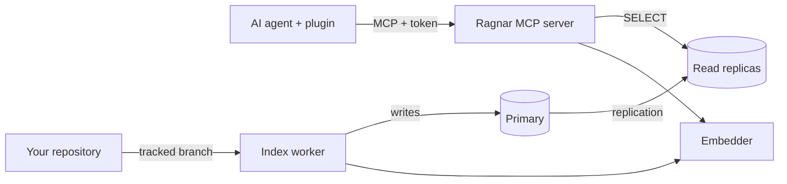

# Ragnar

**Ragnarize your codebase.** Ragnar helps AI coding agents find the right code with fewer tokens. It indexes the commits of your branches in Postgres, on your own infrastructure, and serves a read-only search over MCP. A Claude Code plugin sets the project up, measures the result and keeps the index healthy.

[Português (Brasil)](README.pt-BR.md) · [MIT License](LICENSE) · [Changelog](CHANGELOG.md)

## Why

Agents find code with greps and partial reads. That works when the words of the question appear in the code. Ragnar adds search by concept, exact symbols and callers, in a read-only index.

In a [benchmark](benchmark/README.md) on 8 open source projects in Delphi, Java, C# and Go, the right file ranked much higher than with grep: MRR 0.67 against 0.36 on 350 questions kept out of all tuning. In real agent sessions, answers were just as correct in 22% fewer turns, but they did not cost fewer tokens. Those projects are small to medium. See the [report](benchmark/report.html).

- Bounded results: each search returns a budgeted set of snippets with `path:line`, and references to what did not fit.
- Better results: hybrid search understands both business concepts and exact symbol names.
- Your code stays with you: the index runs on your infrastructure. The MCP server is read-only.
- Any model: agents connect over MCP. Embeddings, reranking and chat use any compatible endpoint, local or hosted.
- Measured: `ragnar eval` compares retrieval with a grep baseline on your own git history.

## How it works



You run the server side from [`example/`](example/README.md). The worker follows a branch of your project, so each merge reaches the index on its own. The plugin connects your agent and guides it through the rest.

## Quick start

You need [uv](https://docs.astral.sh/uv/getting-started/installation/), git, and Docker for the server side. Everything else is optional: see [Requirements](docs/getting-started.md#requirements).

1. Install the plugin in Claude Code:

   ```text
   /plugin install ragnar --marketplace pedrojr/ragnar
   ```

2. Start the infrastructure. Follow [`example/README.md`](example/README.md), or ask your agent to run the `infra` skill.
3. Set the MCP URL and token when Claude Code prompts for them, or later in `/plugin`.
4. Ragnarize your project:

   ```text
   /ragnar:ragnarize
   ```

The walkthrough, with what you should see at each step, is in [Getting started](docs/getting-started.md). For Cursor, Codex and other MCP clients, see [Other agents](docs/agents.md).

## What you get

| Skill | Purpose |
| --- | --- |
| `ragnarize` | Sets a project up: `.ragnar/`, `.rag/`, `.gitignore`, MCP connection |
| `search` | Picks the cheapest way to find code: local tools or the index |
| `index` | First build, on-demand refresh, and team access |
| `evaluate` | Measures recall, cost and confidence against a grep baseline |
| `tune` | Chooses retrieval techniques with evidence |
| `maintain` | Checks health and fixes a stale or failing index |
| `infra` | Brings up the server side from the example |

The MCP server exposes `search_code`, `find_symbol`, `find_references`, `call_graph`, `trace_flow`, `find_table_usage`, `repo_map`, `file_outline`, `read_code` and `list_repos`. See [MCP server](docs/mcp.md).

## Languages

Python, JavaScript, TypeScript, Java, Kotlin, C#, Go, Rust, C, C++, PHP, Ruby, Swift, Scala, Bash, SQL and **Delphi**.

Each language has its own rules for symbols, tests and generated files. Delphi gets legacy support: UTF-16 and CP-1252 sources, and `.dfm` forms reduced to their SQL and event bindings. See [Languages](docs/languages.md).

## Retrieval techniques

Every technique is a setting. The server's `server.toml` owns most of them, and a repository sets only its `[index]` keys. They are AST-aware chunking, hybrid search with weighted RRF, exact symbol boost, reranking, multi-query, HyDE, contextual retrieval, MMR diversity, neighbor chunks and a token budget. Presets cover the common cases. Embeddings are always on; LLM summaries are optional. See [Retrieval techniques](docs/retrieval.md) and [Configuration](docs/configuration.md).

## Documentation

| Guide | Content |
| --- | --- |
| [Getting started](docs/getting-started.md) | Adoption, step by step |
| [Configuration](docs/configuration.md) | Every setting |
| [Retrieval techniques](docs/retrieval.md) | What each technique costs and gives |
| [Languages](docs/languages.md) | Supported languages, Delphi notes, adding a language |
| [MCP server](docs/mcp.md) | Tools, access control, metrics |
| [Other agents](docs/agents.md) | Using Ragnar outside Claude Code |
| [Evaluation](docs/evaluation.md) | How the measurements work |
| [Architecture](docs/architecture.md) | Components and design decisions |
| [Example infrastructure](example/README.md) | Compose and Kubernetes |

## Status

Alpha. The index and the MCP server work end to end, but settings may still change before 1.0. Read [SECURITY.md](SECURITY.md) before you put a server on a shared network.

## Contributing

Contributions are welcome. Read [CONTRIBUTING.md](CONTRIBUTING.md). This project follows the [Code of Conduct](CODE_OF_CONDUCT.md).

## License

[MIT](LICENSE) © Pedro Júnior
