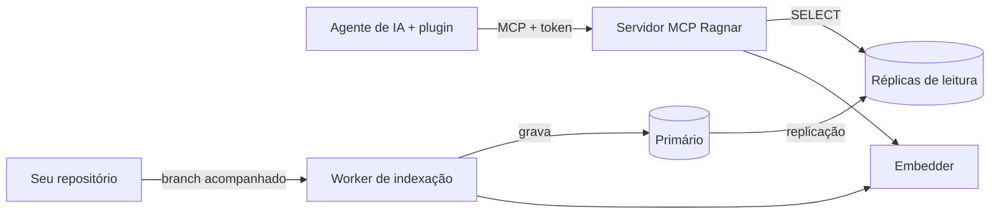

# Ragnar

**Ragnarize sua base de código.** O Ragnar ajuda agentes de IA a achar o código certo gastando menos tokens. Ele indexa os commits dos seus branches no Postgres, na sua própria infraestrutura, e serve uma busca somente leitura por MCP. Um plugin do Claude Code configura o projeto, mede o resultado e mantém o índice saudável.

[English](README.md) · [Licença MIT](LICENSE) · [Changelog](CHANGELOG.pt-BR.md)

## Por quê

Agentes acham código com greps e leituras parciais. Isso funciona quando as palavras da pergunta aparecem no código. O Ragnar acrescenta busca por conceito, símbolos exatos e quem chama o quê, em um índice somente leitura.

Em um [benchmark](benchmark/README.pt-BR.md) com 8 projetos open source em Delphi, Java, C# e Go, o arquivo certo apareceu bem mais alto que com grep: MRR 0,67 contra 0,36 em 350 perguntas mantidas fora de todo ajuste. Em sessões reais de agente, as respostas acertaram igual, com 22% menos turnos, mas não custaram menos tokens. Esses projetos são de pequeno a médio porte. Veja o [relatório](benchmark/report.pt-BR.html).

- Resultados limitados: cada busca devolve trechos dentro de um orçamento, com `path:linha`, e referências para o que não coube.
- Resultados melhores: a busca híbrida entende conceitos de negócio e nomes exatos de símbolos.
- Seu código fica com você: o índice roda na sua infraestrutura. O servidor MCP é somente leitura.
- Qualquer modelo: agentes conectam por MCP. Embeddings, reranking e chat usam qualquer endpoint compatível, local ou hospedado.
- Medido: `ragnar eval` compara a recuperação com um baseline de grep no seu próprio histórico do git.

## Como funciona



Você sobe o lado servidor a partir de [`example/`](example/README.pt-BR.md). O worker acompanha um branch do seu projeto, então cada merge chega ao índice sozinho. O plugin conecta seu agente e o guia no resto.

## Início rápido

Você precisa de [uv](https://docs.astral.sh/uv/getting-started/installation/), git e Docker para o lado servidor. O resto é opcional: veja [Requisitos](docs/pt-BR/getting-started.md#requisitos).

1. Instale o plugin no Claude Code:

   ```text
   /plugin install ragnar --marketplace pedrojr/ragnar
   ```

2. Suba a infraestrutura. Siga o [`example/README.pt-BR.md`](example/README.pt-BR.md) ou peça ao agente para usar a skill `infra`.
3. Informe a URL e o token do MCP quando o Claude Code pedir, ou depois em `/plugin`.
4. Ragnarize seu projeto:

   ```text
   /ragnar:ragnarize
   ```

O passo a passo completo está em [Primeiros passos](docs/pt-BR/getting-started.md). Para Cursor, Codex e outros clientes MCP, veja [Outros agentes](docs/pt-BR/agents.md).

## O que vem no plugin

| Skill | Finalidade |
| --- | --- |
| `ragnarize` | Prepara o projeto: `.ragnar/`, `.rag/`, `.gitignore`, conexão MCP |
| `search` | Escolhe o jeito mais barato de achar código: ferramentas locais ou índice |
| `index` | Primeira indexação, atualização sob demanda e acesso de times |
| `evaluate` | Mede recall, custo e confiança contra um baseline de grep |
| `tune` | Escolhe técnicas de recuperação com evidência |
| `maintain` | Confere a saúde e corrige índice defasado ou com falha |
| `infra` | Sobe o lado servidor a partir do exemplo |

O servidor MCP expõe `search_code`, `find_symbol`, `find_references`, `call_graph`, `trace_flow`, `find_table_usage`, `repo_map`, `file_outline`, `read_code` e `list_repos`. Veja [Servidor MCP](docs/pt-BR/mcp.md).

## Linguagens

Python, JavaScript, TypeScript, Java, Kotlin, C#, Go, Rust, C, C++, PHP, Ruby, Swift, Scala, Bash, SQL e **Delphi**.

Cada linguagem tem regras próprias para símbolos, testes e arquivos gerados. Delphi tem suporte a legado: fontes em UTF-16 e CP-1252, e formulários `.dfm` reduzidos ao SQL e aos eventos. Veja [Linguagens](docs/pt-BR/languages.md).

## Técnicas de recuperação

Toda técnica é uma configuração. O `server.toml` do servidor é dono da maioria, e um repositório define só as chaves de `[index]`. São elas: chunking por AST, busca híbrida com RRF ponderado, reforço por símbolo exato, reranking, multi-query, HyDE, recuperação contextual, diversidade MMR, chunks vizinhos e orçamento de tokens. Presets cobrem os casos comuns. Os embeddings estão sempre ligados; os resumos por LLM são opcionais. Veja [Técnicas de recuperação](docs/pt-BR/retrieval.md) e [Configuração](docs/pt-BR/configuration.md).

## Documentação

| Guia | Conteúdo |
| --- | --- |
| [Primeiros passos](docs/pt-BR/getting-started.md) | Adoção, passo a passo |
| [Configuração](docs/pt-BR/configuration.md) | Todas as opções |
| [Técnicas de recuperação](docs/pt-BR/retrieval.md) | O que cada técnica custa e entrega |
| [Resumos de arquivos](docs/pt-BR/summaries.md) | Resumos em linguagem de negócio com Ollama ou Claude Haiku |
| [Linguagens](docs/pt-BR/languages.md) | Linguagens suportadas, Delphi, como adicionar uma linguagem |
| [Servidor MCP](docs/pt-BR/mcp.md) | Ferramentas, controle de acesso, métricas |
| [Outros agentes](docs/pt-BR/agents.md) | Usar o Ragnar fora do Claude Code |
| [Avaliação](docs/pt-BR/evaluation.md) | Como as medições funcionam |
| [Arquitetura](docs/pt-BR/architecture.md) | Componentes e decisões de projeto |
| [Infraestrutura de exemplo](example/README.pt-BR.md) | Compose e Kubernetes |

## Situação

Alfa. O índice e o servidor MCP funcionam de ponta a ponta, mas as configurações ainda podem mudar antes da 1.0. Leia o [SECURITY.pt-BR.md](SECURITY.pt-BR.md) antes de colocar um servidor em rede compartilhada.

## Como contribuir

Contribuições são bem-vindas. Leia o [CONTRIBUTING.pt-BR.md](CONTRIBUTING.pt-BR.md). Este projeto segue o [Código de Conduta](CODE_OF_CONDUCT.pt-BR.md).

## Licença

[MIT](LICENSE) © Pedro Júnior
