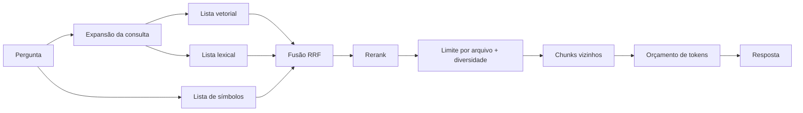

# Técnicas de recuperação

O Ragnar expõe as técnicas atuais de RAG como configuração. Comece com o padrão e deixe o [`ragnar eval`](evaluation.md) decidir o que adicionar: técnicas custam dinheiro ou latência, e o ganho depende da base de código.

[English](../retrieval.md)

## O pipeline

Etapas que usam um modelo opcional vêm desligadas.

## Na consulta

| Técnica | Configuração | Custo | Melhor para |
| --- | --- | --- | --- |
| Busca híbrida | `retrieval.mode` | Nenhum | Quase toda base. Mantenha, salvo se uma avaliação disser o contrário |
| RRF ponderado | `retrieval.*_weight`, `rrf_k` | Nenhum | Favorecer nomes ou conceitos |
| Reforço por símbolo | `retrieval.symbol_weight` | Nenhum | Perguntas que citam classe ou função |
| Reranking | `[rerank]` | Uma chamada de modelo por busca | Melhores resultados fora de ordem |
| Multi-query | `query.strategy = "multi_query"` | Uma chamada de chat e mais embeddings por busca | Perguntas vagas |
| HyDE | `query.strategy = "hyde"` | Uma chamada de chat por busca | Perguntas em linguagem natural em código pouco documentado |
| Limite por arquivo | `retrieval.max_chunks_per_file` | Nenhum | Um arquivo grande tomando todos os resultados |
| Diversidade (MMR) | `retrieval.diversity` | Nenhum | Resultados quase duplicados |
| Chunks vizinhos | `retrieval.neighbor_chunks` | Mais tokens por busca | Lugar certo, contexto curto |
| Orçamento de tokens | `retrieval.max_context_tokens` | Nenhum | Custo previsível para o agente |

### Como as listas se combinam

O **Reciprocal Rank Fusion** ordena por posição, não por pontuação, então listas vetoriais e lexicais se combinam sem calibração. Um chunk soma `peso / (rrf_k + posição)` por lista. Chunks achados em várias listas sobem.

O **reforço por símbolo** lê identificadores na pergunta e adiciona os chunks que os definem, então "onde `TOrder.Cancel` é usado?" cai na definição.

O **MMR** aqui mede a sobreposição de termos entre chunks, não de vetores. Não exige trabalho extra do banco.

O **orçamento de tokens** é uma estimativa de quatro caracteres por token. Mantém a ordem de grandeza certa entre modelos, e o primeiro resultado sempre fica.

## Na indexação

| Técnica | Configuração | Custo | Melhor para |
| --- | --- | --- | --- |
| Chunking por AST (cAST) | Ligado em linguagens com gramática | Nenhum | Chunks que seguem funções e classes |
| Janelas de linhas | `index.window_lines`, `window_overlap` | Nenhum | Arquivos sem gramática |
| Separação de identificadores | Sempre ligada | Nenhum | Casar `getUserById` com "user by id" |
| Comentário junto da declaração | Sempre ligado | Nenhum | Manter a documentação com o código |
| Extração de formulários | Formulários Delphi | Nenhum | Achar regra de negócio em `.dfm` |
| Recuperação contextual | `contextual.enabled` | Uma chamada de chat por chunk | Chunks sem sentido isolados |

A recuperação contextual é a técnica mais cara aqui, e vale para todo chunk numa reindexação completa. Use um modelo barato e meça uma amostra antes.

## Por onde começar

| Objetivo | Tente |
| --- | --- |
| Reduzir custo | `project.preset = "economy"` |
| Melhorar o topo, custo moderado | Um reranker |
| Perguntas vagas | `query.strategy = "multi_query"` |
| Legado com nomes ruins | `retrieval.vector_weight = 1.5`, `contextual.enabled = true` |

Meça cada mudança. Ganhos raramente se somam.
