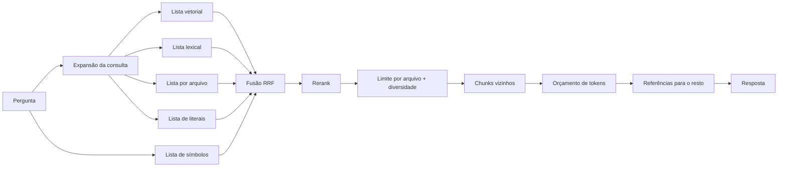

# Técnicas de recuperação

O Ragnar expõe as técnicas atuais de RAG como configuração. Comece com o padrão e deixe o [`ragnar eval`](evaluation.md) decidir o que adicionar: técnicas custam dinheiro ou latência, e o ganho depende da base de código.

[English](../retrieval.md)

## O pipeline

Etapas que usam um modelo opcional vêm desligadas.

## Na consulta

| Técnica | Configuração | Custo | Melhor para |
| --- | --- | --- | --- |
| Busca híbrida | `retrieval.mode` | Nenhum | Quase toda base. Mantenha, salvo se uma avaliação disser o contrário |
| RRF ponderado | `retrieval.*_weight`, `rrf_k` | Nenhum | Favorecer nomes ou conceitos |
| Reforço por símbolo | `retrieval.symbol_weight` | Nenhum | Perguntas que citam classe ou função |
| Lista por arquivo | `retrieval.file_weight` | Duas consultas a mais | Arquivos grandes, onde as palavras da pergunta ficam distantes |
| Lista do grafo | `retrieval.graph_weight` | Uma consulta a mais | Fluxos entre arquivos: o que os melhores resultados chamam e quem os chama |
| Lista de literais | `retrieval.literal_weight` | Uma consulta a mais, só com texto entre aspas | Mensagens de erro, textos de tela e SQL que a pessoa cita |
| Reranking | `[rerank]` | Uma chamada de modelo por busca | Melhores resultados fora de ordem |
| Multi-query | `query.strategy = "multi_query"` | Uma chamada de chat e mais embeddings por busca | Perguntas vagas |
| HyDE | `query.strategy = "hyde"` | Uma chamada de chat por busca | Perguntas em linguagem natural em código pouco documentado |
| Limite por arquivo | `retrieval.max_chunks_per_file` | Nenhum | Um arquivo grande tomando todos os resultados |
| Diversidade (MMR) | `retrieval.diversity` | Nenhum | Resultados quase duplicados |
| Chunks vizinhos | `retrieval.neighbor_chunks` | Mais tokens por busca | Lugar certo, contexto curto |
| Orçamento de tokens | `retrieval.max_context_tokens` | Nenhum | Custo previsível para o agente |
| Trechos focados | `retrieval.excerpts` | Nenhum | Caber mais resultados no orçamento: depois do primeiro, cada resultado mantém só as linhas numeradas em volta das palavras da pergunta |
| Referências | `retrieval.reference_hits` | Cerca de 25 tokens cada | Manter o recall quando o orçamento acaba |

### Como as listas se combinam

O **Reciprocal Rank Fusion** ordena por posição, não por pontuação, então listas vetoriais e lexicais se combinam sem calibração. Um chunk soma `peso / (rrf_k + posição)` por lista. Chunks achados em várias listas sobem.

O **ranking lexical** segue o BM25 em Postgres puro. Cada termo pesa pela raridade, stopwords em inglês e português saem, palavras do path e do símbolo pontuam acima do corpo, e um stemming leve deixa "escaped" achar `EscapeString` e "cancelamento" achar `CancelarPedido`. Acentos não contam: "configuração" e "configuracao" acham o mesmo código. Um termo presente em mais de um quarto dos chunks ordena resultados, mas não os seleciona. Palavras para partes da tela trazem os nomes que o código dá a elas: "botão" também pede `button` e `btn`, "duplo clique" pede `Dbl` e `Click`.

A **lista por arquivo** cobre o que chunks não alcançam: um chunk raramente tem todas as palavras de uma pergunta. Os arquivos com mais peso da consulta somado entre seus chunks entram na fusão pelo melhor chunk. Isso dá ao Ragnar a força que o grep tem em arquivos grandes. Os arquivos pontuam como documentos do BM25, com o chunk como unidade: um arquivo ganha com mais chunks que têm o termo e perde um pouco pelo tamanho. Sem essa penalidade, as units utilitárias de 20 000 linhas de um monorepo têm todas as palavras e ganham todas as perguntas.

As **strings literais** (mensagens, captions de formulário, hints e SQL) formam um campo próprio, com peso entre o path e o corpo. Quando a pergunta cita um texto, como em `erro "cliente sem limite de crédito"`, a **lista de literais** traz os chunks cujas strings têm todas as palavras citadas. Ela fica desligada em perguntas sem aspas: em todas as consultas, custou de 0,05 a 0,09 de MRR no benchmark, embora tenha dobrado o MRR das perguntas de sintoma.

O **reforço por símbolo** lê identificadores na pergunta e adiciona os chunks que os definem, então "onde `TOrder.Cancel` é usado?" cai na definição. Numa frase, só contam as palavras que parecem código.

O **MMR** aqui mede a sobreposição de termos entre chunks, não de vetores. Não exige trabalho extra do banco.

O **orçamento de tokens** é uma estimativa de quatro caracteres por token. Mantém a ordem de grandeza certa entre modelos, e o primeiro resultado sempre fica. Resultados que não cabem voltam como referências, com path, linhas e símbolo, e o agente ainda sabe onde olhar em seguida.

## Na indexação

| Técnica | Configuração | Custo | Melhor para |
| --- | --- | --- | --- |
| Chunking por AST (cAST) | Ligado em linguagens com gramática | Nenhum | Chunks que seguem funções e classes |
| Janelas de linhas | `index.window_lines`, `window_overlap` | Nenhum | Arquivos sem gramática |
| Separação de identificadores | Sempre ligada | Nenhum | Casar `getUserById` com "user by id" |
| Comentário junto da declaração | Sempre ligado | Nenhum | Manter a documentação com o código |
| Extração de formulários | Formulários Delphi | Nenhum | Achar regra de negócio em `.dfm` |
| Formulário para handler | Formulários Delphi | Nenhum | Chegar ao handler no `.pas` pelo caption e pelo componente que a pessoa vê na tela |
| Recuperação contextual | `contextual.enabled` | Uma chamada de chat por chunk | Chunks sem sentido isolados |
| Resumos de arquivo | `summaries.enabled` | Uma chamada de chat por arquivo novo ou alterado | Perguntas de negócio com palavras que o código não usa |

A recuperação contextual é a técnica mais cara aqui, e vale para todo chunk numa reindexação completa. Use um modelo barato e meça uma amostra antes.

## Por onde começar

| Objetivo | Tente |
| --- | --- |
| Reduzir custo | `project.preset = "economy"` |
| Melhorar o topo, custo moderado | Um reranker |
| Perguntas vagas | `query.strategy = "multi_query"` |
| Legado com nomes ruins | `summaries.enabled = true` com um modelo barato, depois `retrieval.vector_weight = 1.5` |
| Perguntas sobre fluxos entre arquivos | `retrieval.graph_weight = 0.5`, e as ferramentas `trace_flow` e `call_graph` |
| Monorepo grande com units utilitárias | `retrieval.rank_normalization = 2` |

Meça cada mudança. Ganhos raramente se somam.
