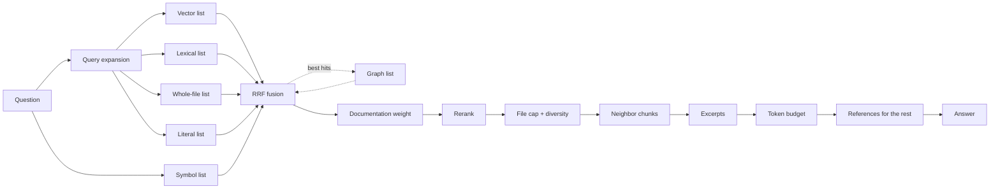

# Retrieval techniques

Ragnar exposes the current RAG techniques as settings. Start with the defaults, then let [`ragnar eval`](evaluation.md) decide what to add: techniques cost money or latency, and their gains depend on the codebase.

[Português (Brasil)](pt-BR/retrieval.md)

## The pipeline

Stages with an optional model are off by default, and so is the graph list (dotted).

## At query time

| Technique | Setting | Cost | Best for |
| --- | --- | --- | --- |
| Hybrid search | `retrieval.mode` | None | Almost every codebase. Keep it unless an evaluation says otherwise |
| Weighted RRF | `retrieval.*_weight`, `rrf_k` | None | Favoring names or concepts |
| Symbol boost | `retrieval.symbol_weight` | None | Questions that name a class or function |
| Whole-file list | `retrieval.file_weight` | Two more queries | Large files, where the words of a question sit far apart |
| Graph list | `retrieval.graph_weight` | One more query | Flows across files: what the best hits call, and who calls them |
| Documentation weight | `retrieval.doc_weight` | None | Overview documents that mention every module and crowd out the code |
| Literal list | `retrieval.literal_weight` | One more query, only for quoted text | Error messages, screen captions and SQL that a person quotes |
| Reranking | `[rerank]` | One model call per search | Top results in the wrong order |
| Multi-query | `query.strategy = "multi_query"` | One chat call and more embeddings per search | Vague questions |
| HyDE | `query.strategy = "hyde"` | One chat call per search | Natural-language questions on code with little documentation |
| Per-file cap | `retrieval.max_chunks_per_file` | None | One large file crowding out the rest |
| Diversity (MMR) | `retrieval.diversity` | None | Near-duplicate hits |
| Neighbor chunks | `retrieval.neighbor_chunks` | More tokens per search | Right spot, too little context |
| Token budget | `retrieval.max_context_tokens` | None | Keeping agent costs predictable |
| Excerpts | `retrieval.excerpts` | None | Fitting more hits in the token budget: hits after the first keep only numbered lines around the query words |
| References | `retrieval.reference_hits` | About 25 tokens each | Keeping recall when the budget runs out |

### How the lists combine

**Reciprocal Rank Fusion** ranks by position, not score, so vector and lexical results combine without calibration. A chunk scores `weight / (rrf_k + rank)` per list. Chunks found by several lists rise.

**Lexical ranking** follows BM25 on plain Postgres. Each term weighs by its rarity, English and Portuguese stopwords drop out, words in the path and symbol score above the body, and light stemming lets "escaped" find `EscapeString` and "cancelamento" find `CancelarPedido`. Accents do not count: "configuração" and "configuracao" match the same code. A term in more than a quarter of the chunks ranks results, but it does not select them. Words for screen parts bring the names code gives them: "botão" also asks for `button` and `btn`, "duplo clique" for `Dbl` and `Click`.

**The whole-file list** covers what chunks cannot: a chunk rarely holds every word of a question. Files holding the most query weight across their chunks join the fusion through their best chunk. This gives Ragnar the strength grep has on large files. Files are scored like BM25 documents, with chunks as the unit: a file gains from more chunks holding a term, and loses a little for its size. Without that penalty, a monorepo's utility units of 20 000 lines hold every word and win every question.

**String literals** (messages, form captions, hints and SQL) are a field of their own, weighted between the path and the body. When a question quotes text, as in `error "customer over credit limit"`, **the literal list** adds the chunks whose literals hold every quoted word. It stays off for unquoted questions: on every query it cost 0.05 to 0.09 of MRR in the benchmark, though it doubled the MRR of symptom questions.

**Symbol boost** reads identifiers from the question and adds chunks that define them, so "where is `TOrder.Cancel` used?" lands on the definition. In a sentence, only words that read like code count.

**MMR** here measures overlap between chunk terms, not vectors. It costs no extra database work.

**The token budget** is an estimate of four characters per token. It keeps the order of magnitude right across models, and the first hit is always kept. Hits that do not fit return as references, with path, lines and symbol, so an agent still knows where to look next.

## At index time

| Technique | Setting | Cost | Best for |
| --- | --- | --- | --- |
| AST chunking (cAST) | On for languages with a grammar | None | Chunks that follow functions and classes |
| Line windows | `index.window_lines`, `window_overlap` | None | Files without a grammar |
| Identifier splitting | Always on | None | Matching `getUserById` with "user by id" |
| Comment attachment | Always on | None | Keeping documentation with its code |
| Form extraction | Delphi forms | None | Finding business logic in `.dfm` files |
| Form to handler | Delphi forms | None | Reaching the handler in the `.pas` from the caption and component a person sees on the screen |
| Contextual retrieval | `contextual.enabled` | One chat call per chunk | Chunks that make no sense alone |
| File summaries | `summaries.enabled` | One chat call per new or changed file | Business questions whose words the code does not use |

Embeddings are always on and summaries are optional: see [Embeddings and summaries](configuration.md#embeddings-and-summaries).

Contextual retrieval has the highest cost here, and it applies to every chunk in a full reindex. Use a cheap model, and measure a sample first.

## Starting points

| Goal | Try |
| --- | --- |
| Reduce cost | `project.preset = "economy"` |
| Better top results, moderate cost | A reranker |
| Vague questions | `query.strategy = "multi_query"` |
| Legacy code with poor naming | `summaries.enabled = true` on a cheap model, then `retrieval.vector_weight = 1.5` |
| Questions about flows across files | `retrieval.graph_weight = 0.5`, and the `trace_flow` and `call_graph` tools |
| Large monorepo of utility units | `retrieval.rank_normalization = 2` |

Measure each change. Gains rarely add up.
