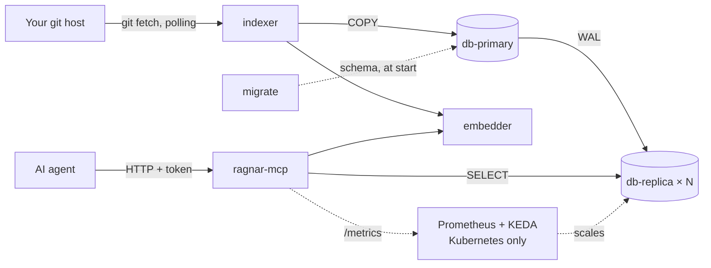

# Example infrastructure

This folder runs the server side of Ragnar on your own machines: the database, the embedder, the MCP server, and a worker that keeps the index up to date with a branch of your project.

[Português (Brasil)](README.pt-BR.md)



- **One writer.** Only the worker writes to the index, and only on the primary. The `migrate` job applies the schema when the stack comes up.
- **Read-only search.** The MCP server reads from replicas, with a role that can only `SELECT`.
- **No inbound network.** The worker polls your git host, every minute under Compose and every 5 minutes under Kubernetes, so nothing has to reach this machine.

## Requirements

- Docker Desktop, or Docker Engine with Compose, on Windows, macOS or Linux. For Kubernetes, turn it on under *Settings > Kubernetes*. On Windows, run `wsl --update` first: recent Kubernetes versions do not start on the cgroup v1 of older WSL kernels.
- [uv](https://docs.astral.sh/uv/getting-started/installation/) and git. On Windows, run the scripts in Git Bash.
- About 6 GB of free memory for Docker. The embedder uses up to 3 GB while indexing.

Clone Ragnar and work from this folder:

```bash
git clone https://github.com/pedrojr/ragnar
cd ragnar/example
```

## Option 1: Docker Compose

Best for one team on one machine. Scaling is manual.

**1. Create the local files.** This writes `.env` (random passwords and tokens), `acl.json` and `repos.toml`. Git ignores all three. Never commit them.

```bash
uv run --project .. ragnar init-env
```

**2. Choose what to follow.** Edit `repos.toml`:

```toml
[[repo]]
name = "myapp"                                # name in the index
url = "https://github.com/acme/myapp.git"
branch = "main"                               # branch the index follows
```

For a private repository, add `token_env = "RAGNAR_GIT_TOKEN"` to the entry, and put a read-only token in `.env`:

```bash
echo 'RAGNAR_GIT_TOKEN=<read-only token>' >> .env
```

The token travels in a request header, so it stays out of URLs, the mirror and error messages. GitHub and GitLab accept this form.

To leave folders out, such as vendored libraries, add `exclude = ["vendor/*", "lib/*"]` to the entry. When the repository's own `.ragnar/config.toml` sets `index.exclude`, that list replaces this one.

To follow a clone on this machine, mount it into the worker with a local override file, and use the mount point as `url`:

```yaml
# compose.local.yaml
services:
  indexer:
    volumes:
      - /path/to/myapp:/src/myapp:ro
```

```bash
docker compose -f compose.yaml -f compose.local.yaml up -d --build --scale db-replica=2
```

**3. Start everything.** The first build downloads the embedding model, so it takes a few minutes.

```bash
docker compose up -d --build --scale db-replica=2
```

**4. Follow the first index.** On CPU, expect about one second per chunk with the default 4 embedder threads. For a large repository, set `RAGNAR_EMBED_THREADS` (and `RAGNAR_EMBED_MEMORY`, default `3g`) in `.env` before step 3. With 14 threads, a repository of 40 000 chunks took about 5 hours. If the run stops, the next one keeps the vectors already computed.

```bash
docker compose logs -f indexer
```

It ends with a line such as `myapp: full at 3f2a9c1b7d10: 412 files, 1830 chunks, 1902.4s`. Later passes print `unchanged` or `incremental`.

**5. Check the result.** Nine checks cover the token, the ACL, the tools and the write barriers.

```bash
./scripts/smoke.sh myapp
```

**6. Connect your agent.** Use `http://127.0.0.1:8080/mcp` and the `RAGNAR_MCP_TOKEN` value from `.env`. In Claude Code, set them in `/plugin`.

**7. Confirm it follows the branch.** Push a commit to the tracked branch, wait for the next pass, and call `list_repos`: the commit changes.

### Ports

Every port binds to `127.0.0.1`.

| Port | Service | Used by |
| --- | --- | --- |
| 8080 | MCP (`/mcp`, `/metrics`, `/readyz`) | agents |
| 15432 | Postgres primary | `scripts/index.sh` on the host |
| 8001 | Embedder (`/v1/embeddings`) | `scripts/index.sh` on the host |

Replicas are not published. To add replicas: `docker compose up -d --scale db-replica=3`.

### Day-to-day

| Task | Command |
| --- | --- |
| Follow another repository | Edit `repos.toml`, then `docker compose restart indexer` |
| Change the polling interval | Set `RAGNAR_SYNC_INTERVAL` in `.env`, then `docker compose up -d indexer` |
| Index now, from a local clone | `./scripts/index.sh /path/to/myapp myapp` |
| Rebuild one repository | `./scripts/index.sh /path/to/myapp myapp --full` |
| Create a team token | `uv run --project .. ragnar token --name team-a --repos myapp` |
| Reload the ACL | `docker compose restart ragnar-mcp` |
| Change retrieval settings | Edit `server.toml`, then `docker compose restart ragnar-mcp indexer` |
| Stop, keeping the index | `docker compose down` |
| Stop and **delete the index** | `docker compose down -v` |

## Option 2: Kubernetes

Best when load varies. This setup targets Docker Desktop, and it scales by itself. Stop Compose first, since both use port 8080.

```bash
docker compose down
./scripts/up.sh                                   # operators, images, secrets, database, MCP
./scripts/index.sh /path/to/myapp myapp --target k8s
./scripts/smoke.sh myapp --target k8s
```

`up.sh` is safe to run again, and it reloads `repos.toml`, `acl.json` and `server.toml`, plus the model keys in `.env`. It also rebuilds the images. When Docker Desktop runs Kubernetes with the kind provisioner, each node keeps its own copy of the images, so `up.sh` copies any image that changed into the nodes and restarts the pods that use it. It installs fixed versions of metrics-server 0.9.0, CloudNativePG 1.30.1 and KEDA 2.21.0, then creates:

| Resource | What it is | Scaling |
| --- | --- | --- |
| `Cluster/ragnar-db` | CNPG primary and replicas; services `ragnar-db-rw` and `ragnar-db-ro` | KEDA, 2 to 4 instances, by searches/s |
| `Deployment/ragnar-mcp` | MCP server, `LoadBalancer` on `localhost:8080` | HPA on CPU, 1 to 5 pods |
| `Deployment/ragnar-embedder` | Python embedder | HPA on CPU, 1 to 3 pods |
| `CronJob/ragnar-indexer` | The worker, every 5 minutes | One Job at a time |
| `Deployment/prometheus` | Collects `ragnar_search_total` for KEDA | Fixed |

To index right after a merge, run from CI:

```bash
kubectl -n ragnar create job --from=cronjob/ragnar-indexer idx-$(date +%s)
```

`index.sh --target k8s` runs the indexer in a temporary pod, with the worker's settings and through the Services, so it uses every embedder pod. A local clone travels as a git bundle, which holds commits only. For the first build of a large repository, prefer the CronJob: it does not depend on a `kubectl exec` session that stays open for hours.

Docker Desktop publishes the `LoadBalancer` on every network interface, not only on `127.0.0.1`. Other machines on your network can reach port 8080 unless a firewall blocks it. The token still applies.

Load test:

```bash
kubectl apply -f k8s/jobs/load.yaml               # 16 MCP clients, 40 searches/s, 7 minutes
kubectl -n ragnar get hpa,scaledobject,cluster -w
kubectl -n ragnar logs -f job/ragnar-load         # searches/s, p50, p95, errors every 10 s
```

The rule is one replica per 10 searches/s (`k8s/base/db-scaledobject.yaml`). One reference run on Docker Desktop with 20 CPUs reached 4 database instances and 5 MCP pods in about 3.5 minutes. It then held 40 searches/s at p50 23 ms and p95 about 45 ms, with no errors in 16,343 searches. Repeated queries were served by the embedding cache, so varied queries would shift the bottleneck to the embedder.

Remove everything with `./scripts/down.sh`. With `--all`, it also removes the operators.

## Option 3: Index from CI

The worker needs no inbound network, so prefer it. If you want indexing on each push and your runner can reach the database and the embedder, copy a template from [`ci/`](ci/): `github-actions.yml` or `gitlab-ci.yml`.

## Using another embedder

Any endpoint compatible with `/v1/embeddings` works. Set these in `.env`, then run `docker compose up -d`:

```bash
RAGNAR__EMBEDDING__URL=https://api.example.com/v1
RAGNAR__EMBEDDING__MODEL=<model>
RAGNAR__EMBEDDING__DIM=<dimension>
RAGNAR_EMBEDDING_API_KEY=<key>
```

**This sends your source code to that provider.**

On Kubernetes, set the URL, `MODEL` and `DIM` in `k8s/base/embed.env`, keep the key in `.env`, and run `./scripts/up.sh`.

To bake another local model into the image, set the same `MODEL` and `DIM`, and run `docker compose build embedder`. It must be a model fastembed supports.

A new dimension needs a schema change, which clears the index:

```bash
docker compose run --rm tools migrate --resize-embeddings
```

## Troubleshooting

| Symptom | Cause | Action |
| --- | --- | --- |
| `POSTGRES_PASSWORD` error on `up` | `.env` is missing | Run `ragnar init-env` |
| Port 8080 in use | Compose and Kubernetes both running | Stop one |
| Kubernetes stays at `failed to start` on Windows | WSL runs cgroup v1, which recent Kubernetes versions refuse | `wsl --update`, then `wsl --shutdown`, and start Docker Desktop again |
| `secret found` in the worker log | A credential is in the repository | Rotate and remove it. The index stays on the last good commit |
| `... is empty` in the worker log | `token_env` variable is not set | Set it in `.env`, then `docker compose up -d indexer` |
| Embedder restarting | Out of memory | Give Docker more memory, or lower `RAGNAR_EMBED_BATCH` |
| `smoke.sh` fails on `list_repos` | The first index has not finished | Check `docker compose logs indexer` |

## Limits

This is a reference setup, not a hardened deployment.

- Static tokens per client. For production, put an identity provider in front.
- No TLS, NetworkPolicy or PodDisruptionBudget. Put a TLS proxy in front before the server listens beyond `127.0.0.1`. On Docker Desktop, the Kubernetes `LoadBalancer` already listens on every interface.
- No backup. The index derives from git, so recovery means reindexing.
- Compose spreads reads across replicas through Docker DNS, which is only approximate.
