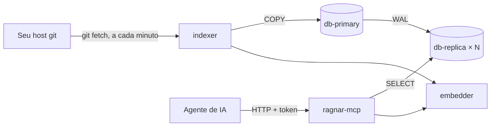

# Infraestrutura de exemplo

Esta pasta roda o lado servidor do Ragnar nas suas máquinas: o banco, o embedder, o servidor MCP e um worker que mantém o índice em dia com um branch do seu projeto.

[English](README.md)



- **Um escritor.** Só o worker grava, e só no primário.
- **Busca somente leitura.** O servidor MCP lê das réplicas, com um papel que só faz `SELECT`.
- **Sem rede de entrada.** O worker consulta seu host git, então nada precisa alcançar esta máquina.

## Requisitos

- Docker Desktop, ou Docker Engine com Compose, em Windows, macOS ou Linux. Para Kubernetes, ligue em *Settings > Kubernetes*.
- [uv](https://docs.astral.sh/uv/getting-started/installation/) e git. No Windows, rode os scripts no Git Bash.
- Cerca de 6 GB de memória livre para o Docker. O embedder usa até 3 GB ao indexar.

Clone o Ragnar e trabalhe nesta pasta:

```bash
git clone https://github.com/pedrojr/ragnar
cd ragnar/example
```

## Opção 1: Docker Compose

Melhor para um time em uma máquina. A escala é manual.

**1. Crie os arquivos locais.** Isso grava `.env` (senhas e tokens aleatórios), `acl.json` e `repos.toml`. O git ignora os três. Nunca faça commit deles.

```bash
uv run --project .. ragnar init-env
```

**2. Escolha o que acompanhar.** Edite o `repos.toml`:

```toml
[[repo]]
name = "myapp"                                # nome no índice
url = "https://github.com/acme/myapp.git"
branch = "main"                               # branch que o índice acompanha
```

Para um repositório privado, adicione `token_env = "RAGNAR_GIT_TOKEN"` à entrada e coloque um token somente leitura no `.env`:

```bash
echo 'RAGNAR_GIT_TOKEN=<token somente leitura>' >> .env
```

O token vai num cabeçalho da requisição, então fica fora de URLs, do espelho e das mensagens de erro. GitHub e GitLab aceitam esse formato.

Para deixar pastas de fora antes de o repositório ter seu próprio `ragnar.toml`, como bibliotecas copiadas para dentro dele, adicione `exclude = ["vendor/*", "lib/*"]` à entrada. Um `ragnar.toml` no repositório substitui essa lista.

Para seguir um clone desta máquina, monte-o no worker com um arquivo de override local e use o ponto de montagem como `url`:

```yaml
# compose.local.yaml
services:
  indexer:
    volumes:
      - /caminho/do/myapp:/src/myapp:ro
```

```bash
docker compose -f compose.yaml -f compose.local.yaml up -d --build --scale db-replica=2
```

**3. Suba tudo.** O primeiro build baixa o modelo de embedding, então leva alguns minutos.

```bash
docker compose up -d --build --scale db-replica=2
```

**4. Acompanhe o primeiro índice.** Em CPU, conte com cerca de um segundo por chunk com as 4 threads padrão do embedder. Para um repositório grande, defina `RAGNAR_EMBED_THREADS` (e `RAGNAR_EMBED_MEMORY`, padrão `3g`) no `.env` antes do passo 3. Com 14 threads, um repositório de 40 000 chunks levou cerca de 5 horas. Se a execução parar, a próxima aproveita os vetores já calculados.

```bash
docker compose logs -f indexer
```

Termina com uma linha como `myapp: full at 3f2a9c1b7d10: 412 files, 1830 chunks, 1902.4s`. As passadas seguintes imprimem `unchanged` ou `incremental`.

**5. Confira o resultado.** Nove verificações cobrem o token, a ACL, as ferramentas e as barreiras de escrita.

```bash
./scripts/smoke.sh myapp
```

**6. Conecte seu agente.** Use `http://127.0.0.1:8080/mcp` e o valor de `RAGNAR_MCP_TOKEN` do `.env`. No Claude Code, informe em `/plugin`.

**7. Confirme que ele acompanha o branch.** Envie um commit ao branch acompanhado, espere a próxima passada e chame `list_repos`: o commit muda.

### Portas

Todas as portas ficam em `127.0.0.1`.

| Porta | Serviço | Usada por |
| --- | --- | --- |
| 8080 | MCP (`/mcp`, `/metrics`, `/readyz`) | agentes |
| 15432 | Primário do Postgres | `scripts/index.sh` no host |
| 8001 | Embedder (`/v1/embeddings`) | `scripts/index.sh` no host |

As réplicas não são publicadas. Para adicionar réplicas: `docker compose up -d --scale db-replica=3`.

### Dia a dia

| Tarefa | Comando |
| --- | --- |
| Acompanhar outro repositório | Edite `repos.toml` e rode `docker compose restart indexer` |
| Mudar o intervalo | Defina `RAGNAR_SYNC_INTERVAL` no `.env` e rode `docker compose up -d indexer` |
| Indexar agora, de um clone local | `./scripts/index.sh /caminho/do/myapp myapp` |
| Refazer um repositório | `./scripts/index.sh /caminho/do/myapp myapp --full` |
| Criar token de um time | `uv run --project .. ragnar token --name time-a --repos myapp` |
| Recarregar a ACL | `docker compose restart ragnar-mcp` |
| Mudar a recuperação | Edite `server.toml` e rode `docker compose restart ragnar-mcp indexer` |
| Parar mantendo o índice | `docker compose down` |
| Parar e **apagar o índice** | `docker compose down -v` |

## Opção 2: Kubernetes

Melhor quando a carga varia. Esta montagem é para o Docker Desktop e escala sozinha. Pare o Compose antes, pois os dois usam a porta 8080.

```bash
docker compose down
./scripts/up.sh                                   # operadores, imagens, segredos, banco, MCP
./scripts/index.sh /caminho/do/myapp myapp --target k8s
./scripts/smoke.sh myapp --target k8s
```

O `up.sh` pode rodar de novo e recarrega `repos.toml` e `acl.json`. Ele instala versões fixas de metrics-server 0.9.0, CloudNativePG 1.30.1 e KEDA 2.21.0, e depois cria:

| Recurso | O que é | Escala |
| --- | --- | --- |
| `Cluster/ragnar-db` | Primário e réplicas do CNPG; serviços `ragnar-db-rw` e `ragnar-db-ro` | KEDA, de 2 a 4 instâncias, por buscas/s |
| `Deployment/ragnar-mcp` | Servidor MCP, `LoadBalancer` em `localhost:8080` | HPA por CPU, de 1 a 5 pods |
| `Deployment/ragnar-embedder` | Embedder Python | HPA por CPU, de 1 a 3 pods |
| `CronJob/ragnar-indexer` | O worker, a cada 5 minutos | Um Job por vez |
| `Deployment/prometheus` | Coleta `ragnar_search_total` para o KEDA | Fixo |

Para indexar logo depois de um merge, rode no CI:

```bash
kubectl -n ragnar create job --from=cronjob/ragnar-indexer idx-$(date +%s)
```

Em repositórios grandes, prefira o CronJob ao `index.sh --target k8s`. Um `port-forward` prende o tráfego num pod, enquanto o CronJob passa pelo Service e usa todos os pods do embedder.

Teste de carga:

```bash
kubectl apply -f k8s/jobs/load.yaml               # 16 clientes MCP, 40 buscas/s, 7 minutos
kubectl -n ragnar get hpa,scaledobject,cluster -w
kubectl -n ragnar logs -f job/ragnar-load         # buscas/s, p50, p95, erros a cada 10 s
```

A regra é uma réplica a cada 10 buscas/s (`k8s/base/db-scaledobject.yaml`). Uma execução de referência no Docker Desktop com 20 CPUs chegou a 4 instâncias de banco e 5 pods do MCP em cerca de 3,5 minutos. Depois manteve 40 buscas/s com p50 de 23 ms e p95 de cerca de 45 ms, sem erros em 16.343 buscas. Consultas repetidas foram atendidas pelo cache de embedding, então consultas variadas deslocariam o gargalo para o embedder.

Remova tudo com `./scripts/down.sh`. Com `--all`, remove também os operadores.

## Opção 3: Indexar pelo CI

O worker não precisa de rede de entrada, então prefira ele. Se quiser indexar a cada push e seu runner alcança o banco e o embedder, copie um modelo de [`ci/`](ci/): `github-actions.yml` ou `gitlab-ci.yml`.

## Usar outro embedder

Qualquer endpoint compatível com `/v1/embeddings` funciona. Defina estas variáveis no `.env` e rode `docker compose up -d`:

```bash
RAGNAR__EMBEDDING__URL=https://api.example.com/v1
RAGNAR__EMBEDDING__MODEL=<modelo>
RAGNAR__EMBEDDING__DIM=<dimensão>
RAGNAR_EMBEDDING_API_KEY=<chave>
```

**Isso envia seu código-fonte a esse provedor.**

Para embutir outro modelo local na imagem, defina os mesmos `MODEL` e `DIM` e rode `docker compose build embedder`. Precisa ser um modelo aceito pelo fastembed.

Uma dimensão nova exige mudar o schema, o que limpa o índice:

```bash
docker compose run --rm tools migrate --resize-embeddings
```

## Problemas comuns

| Sintoma | Causa | Ação |
| --- | --- | --- |
| Erro de `POSTGRES_PASSWORD` no `up` | Falta o `.env` | Rode `ragnar init-env` |
| Porta 8080 em uso | Compose e Kubernetes ligados juntos | Pare um deles |
| `secret found` no log do worker | Há uma credencial no repositório | Troque e remova. O índice fica no último commit bom |
| `... is empty` no log do worker | A variável de `token_env` não está definida | Defina no `.env` e rode `docker compose up -d indexer` |
| Embedder reiniciando | Falta de memória | Dê mais memória ao Docker ou reduza `RAGNAR_EMBED_BATCH` |
| `smoke.sh` falha em `list_repos` | O primeiro índice não terminou | Veja `docker compose logs indexer` |

## Limites

Esta é uma montagem de referência, não um ambiente endurecido.

- Tokens estáticos por cliente. Em produção, coloque um provedor de identidade na frente.
- Sem TLS, NetworkPolicy ou PodDisruptionBudget. Coloque um proxy TLS na frente antes de sair do `127.0.0.1`.
- Sem backup. O índice deriva do git, então recuperar é reindexar.
- O Compose distribui leituras entre réplicas pelo DNS do Docker, de forma apenas aproximada.
